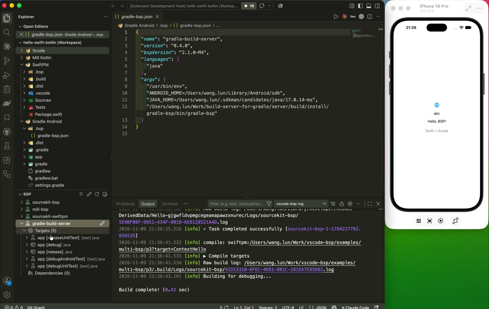
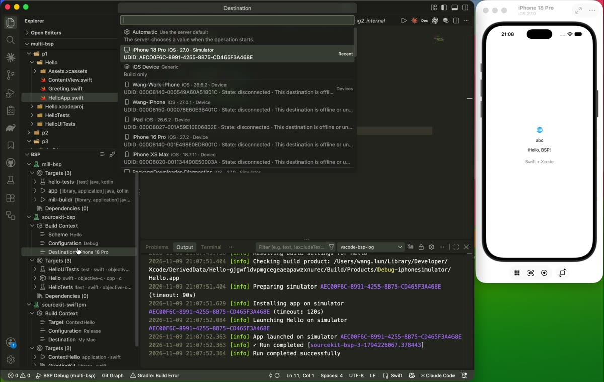
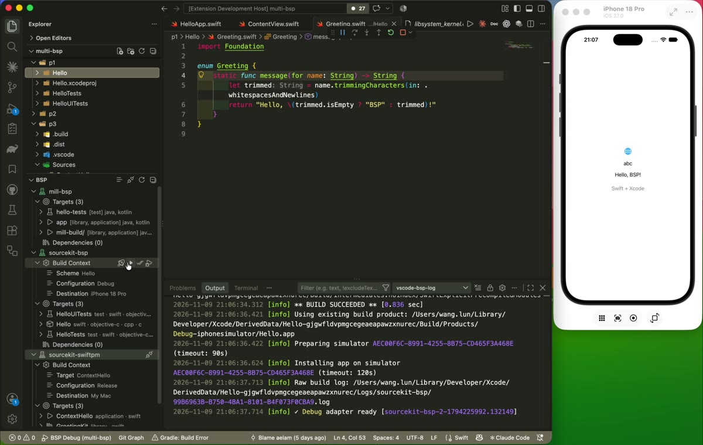
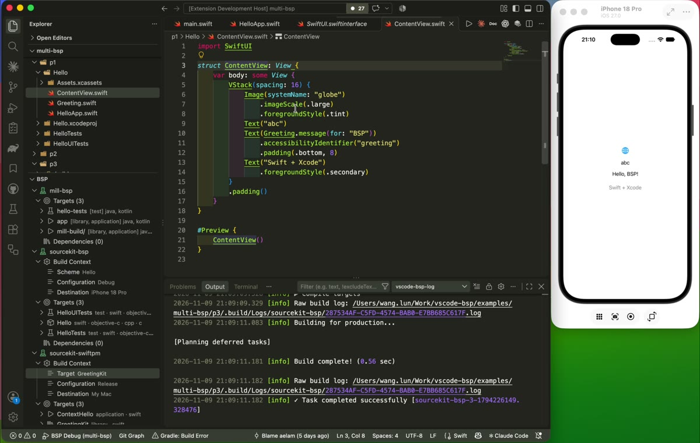

# BSP Client Extension

A general [Build Server Protocol](https://build-server-protocol.github.io/) (BSP)
client for VS Code. Browse targets and dependencies, build, run, test, and debug
through connected servers. Available actions depend on each server's capabilities.
Language extensions provide completion and code navigation separately.

## Video demos

These recordings show multiple BSP servers in one workspace, plus Xcode and
SwiftPM workflows with [sourcekit-bsp](https://github.com/aelam/sourcekit-bsp).
Click a preview to watch the full video.

### Multiple BSP servers

Connect multiple instances of the same server or different BSP servers in one
VS Code workspace. Each connection has its own targets and supported build settings.

[](media/demos/bsp-multiple-connections.mp4)

### Xcode and SwiftPM configuration

Select build settings in the BSP view, including Xcode schemes, configurations,
and destinations.

[](media/demos/bsp-configuration.mp4)

### Run an app

Run an app on the iOS simulator from the BSP view.

[](media/demos/bsp-run.mp4)

### Go to Definition

Navigate to Swift source and SDK definitions with the
[Swift extension](https://github.com/swiftlang/vscode-swift) and SourceKit-LSP,
using build information from [sourcekit-bsp](https://github.com/aelam/sourcekit-bsp).

[](media/demos/bsp-sourcekit.mp4)

## Setup

Requires VS Code 1.74 or later and a BSP server for your build tool.

### Installation

Install a local VSIX with **Extensions: Install from VSIX...**, or follow
[Building from Source](#building-from-source).

Run **BSP: Browse BSP Servers…** from the Command Palette to see setup instructions,
local command status, and homepage links. For example, SourceKit BSP can be installed
with `mint install aelam/sourcekit-bsp`. The extension does not install servers.
It checks known commands on `PATH`; servers without a known command show an unknown
status. You still need a `.bsp` connection file for each server.

### Configuration

Keep connection files in `.bsp/*.json` at each VS Code workspace folder's root.
Each file starts a separate server. Project sources can live in subfolders.
The extension activates when `.bsp` exists, including when Git or search settings
exclude it.

Use your server's setup instructions to generate its connection file:

| Build tool | Server |
| --- | --- |
| Xcode / SwiftPM | [sourcekit-bsp](https://github.com/aelam/sourcekit-bsp) |
| Bazel | [bazel-bsp](https://github.com/JetBrains/bazel-bsp) (archived; see its successor link) |
| Scala | [Bloop](https://scalacenter.github.io/bloop/) |
| sbt | [sbt](https://github.com/sbt/sbt) |
| Mill / Kotlin | [Mill](https://github.com/com-lihaoyi/mill) |
| Gradle / Java | [Build Server for Gradle](https://github.com/microsoft/build-server-for-gradle) |

For sourcekit-bsp, install the server and create `.bsp/sourcekit-bsp.json`:

```json
{
  "name": "sourcekit-bsp",
  "version": "1.0",
  "bspVersion": "2.2.0",
  "languages": ["swift", "c", "cpp", "objective-c", "objective-cpp"],
  "argv": ["sourcekit-bsp"]
}
```

If VS Code cannot find `sourcekit-bsp` on `PATH`, use its absolute path in `argv`.
For Swift code
navigation, install the [Swift extension](https://github.com/swiftlang/vscode-swift).
It runs SourceKit-LSP independently of this client. For Xcode projects,
SourceKit-LSP uses a separate BSP connection; use the same Xcode toolchain for
both. See the server's
[editor setup](https://github.com/aelam/sourcekit-bsp#connect-an-editor) for project selection.

The [multi-BSP example](examples/multi-bsp/README.md) combines Xcode, SwiftPM,
Mill/Kotlin, and optional Gradle/Java projects with tests under one workspace.

## Usage

Open the folder containing `.bsp`. The extension discovers and connects to its
servers automatically. Use **BSP: Connect BSP Servers** to reconnect, or
**BSP: Discover BSP Connections** after adding a connection file.

### BSP View

Run **BSP: Show Build Targets** to open the view in Explorer. Each server contains:

| Group | Contents |
| --- | --- |
| Build Context | Execution settings, when the server supports the [context extension](#build-context-api). |
| Favorites | Saved target shortcuts, stored per workspace and connection. |
| Targets | Targets without the standard `dependency` tag. |
| Dependencies | Targets with the `dependency` tag, collapsed by default. |

Target groups preserve server order and include dependency test targets.
Use the target toolbar or context menu to compile, run, test, or debug.
**BSP: Refresh Build Targets** reloads the target list. The view toolbar also
provides **Collapse All**.

In the Command Palette, use **BSP: Compile Target…** and select a target.
**BSP: Configure Build Context…** edits the workspace settings. Context execution
buttons and commands that require a tree item are available in the BSP view.

### Configuration UI

Expand **Build Context** to load the server's fields and choose their values.
For Xcode, select a Scheme to enable Configuration and Destination. SwiftPM
provides its own fields without an Xcode scheme. Target actions inherit compatible
workspace choices; unavailable choices must be corrected before execution.

Optional fields offer **Automatic** to clear an explicit choice. Pickers with at
least five server options show up to five valid **Recent** choices after a choice
is saved. History is separate for each connection, scope, and field. Destination
pickers group devices, simulators, and generic destinations and show server-provided
platform, version, architecture, and availability.

Normal context actions build first. **Without Building** requires the server's
`reuse` policy and uses existing products. With standard BSP servers, these
commands skip the client's compile step; the server controls whether execution
builds. See [build policies](#build-policies).

### Progress and build output

Operations show their phase and a cancel action. A target stays busy until its
request finishes, including after cancellation. Different targets and connections
can run concurrently; the server controls build scheduling.

Background tasks appear in the status bar. Percentages require a server-provided
total. BSP index preparation is separate from SourceKit-LSP code indexing, and
tasks on SourceKit-LSP's connection are not visible here.

`build/logMessage` appears in **Output → vscode-bsp-log**. Log levels control
theme colors and filtering. Compiler diagnostics appear in **Problems** with
source locations. The client uses the server's severity and does not parse
build-tool output; raw output without a level stays informational.

Choose **Reveal Build Output** on a target to open a product location in the
system file manager. This requires `outputPathsProvider` and
`buildTarget/outputPaths`; the client does not guess output paths.

Choose **Navigate to Folder…** on a target or dependency to reveal its source
folders in Explorer. The client requests `buildTarget/sources` from that item's
server and lists existing source roots and folders before generated sources and
project locations. A target can have sources in several folders. If the server
cannot provide sources, the command uses the target's base directory and URI.

### Clean build cache

Choose **Clean Build Cache…** on a target and confirm the shared-cache warning.
The server decides what to remove. Clean blocks all target actions on that
connection until it completes and has no cancel action. Finish builds, tests,
and indexing in other tools or connections first; the client cannot track them.

### Testing panel

The native VS Code **Testing** panel lists test targets. **Run Tests** uses the
workspace Build Context when supported, or the server defaults. Results include
case status, failure messages, and source links when the server supplies them.
The Stop button cancels the BSP request. Coverage is not available.

For Swift, the discovery adapter uses SourceKit-LSP test discovery version 2 and
the server's advertised toolchain. It discovers XCTest and Swift Testing cases
in Xcode and SwiftPM projects, adds editor run buttons, and supports case selection
and exclusion. Source edits refresh locations; the panel's Refresh action retries
discovery. Parameterized functions run as a whole, without individual argument selection.

Discovery requires exactly one valid Swift/C-family BSP configuration in the
workspace's `.bsp` directory, matching the selected connection. SourceKit-LSP 6.4
cannot choose between multiple matching connections. Move inactive files outside
`.bsp`; a `.json.disabled` suffix does not hide them from SourceKit-LSP.
Target-level testing remains available when case discovery is unavailable.

Other servers use standard `test-start`, `test-finish`, and `test-report` events.
Case navigation and selection require a discovery adapter; display names alone
do not make cases runnable. With sourcekit-bsp, case results arrive after each
target completes. See its [test selection contract](https://github.com/aelam/sourcekit-bsp/blob/main/Docs/wiki/Build-Run-Test-Debug.md#test-discovery-and-selection).

### Tasks and build shortcuts

**Tasks: Run Task** lists `compile`, `run`, and `test` tasks for connected targets.
To configure a default build task, add `.vscode/tasks.json`:

```json
{
  "version": "2.0.0",
  "tasks": [
    {
      "label": "BSP Build",
      "type": "bsp",
      "operation": "compile",
      "connection": ".bsp/sourcekit-bsp.json",
      "target": "Hello",
      "group": { "kind": "build", "isDefault": true },
      "problemMatcher": []
    }
  ]
}
```

Replace the connection file and target with values from your project.
**Tasks: Run Build Task** (`Ctrl+Shift+B`, or `Cmd+Shift+B` on macOS) runs the default task.
Set `operation` to `run` or `test` to execute a target. Set `group` to `test` for
**Tasks: Run Test Task**. Debugging uses `launch.json`.

| Field | Meaning |
| --- | --- |
| `operation` | Required for tasks: `compile`, `run`, or `test`. |
| `target` | Required for tasks. Use an exact BSP target URI or a unique display name. Omit in `launch.json` to choose a target. |
| `connection` | Optional path to a discovered `.bsp/*.json` file, relative to the task or launch workspace folder, or absolute. Use it to distinguish servers. |
| `buildPolicy` | `build` by default. `reuse` uses existing products and requires the server's Build Context support. Compile only accepts `build`. |

Ambiguous targets fail with an error. A configured connection can reconnect when
needed. Tasks and F5 use the current Build Context choices for settings such as
configuration and destination. They do not store a second set of these choices.
Servers without Build Context use standard BSP requests; Run, Test, and Debug
compile first when the target supports compilation.

Task terminals show request progress and logs with a matching `originId`.
Logs without an `originId` remain in **Output → vscode-bsp-log**. Diagnostics still
appear in Problems, and test events still update Testing. Stop a task with
**Tasks: Terminate Task** or `Ctrl+C`. Failed and cancelled tasks return a nonzero
exit code so dependent tasks do not proceed. Background tasks are not supported.


### Debugging with F5

Choose **BSP Debug** in Run and Debug, then press F5. To fix the target and avoid
the target picker, add `.vscode/launch.json`:

```json
{
  "version": "0.2.0",
  "configurations": [
    {
      "name": "BSP Build + Debug",
      "type": "bsp-debug",
      "request": "launch",
      "connection": ".bsp/sourcekit-bsp.json",
      "target": "Hello",
      "buildPolicy": "build"
    }
  ]
}
```

This configuration builds and then starts debugging. It needs no `preLaunchTask`.
The server supplies the debug adapter address; no fixed port is needed. The
client sends DAP `launch` to start debugging. Older servers can still return
launch or attach parameters in the debug response. Omit `target` to use the current Build Context. If no
Context selection is saved, Debug opens a target picker. An explicit `target`
always takes priority.
The target's **Debug Target** action uses the same BSP execution path.

If your server supports `reuse`, you can use the **BSP Build** task above as a
`preLaunchTask` instead. Use this launch configuration to avoid building twice:

```json
{
  "name": "BSP Debug after task",
  "type": "bsp-debug",
  "request": "launch",
  "connection": ".bsp/sourcekit-bsp.json",
  "target": "Hello",
  "preLaunchTask": "BSP Build",
  "buildPolicy": "reuse"
}
```

Keep the task and launch connection and target consistent. VS Code runs the task
before the extension requests a debug session. Without `preLaunchTask`, `reuse`
starts debugging existing products. Servers that do not advertise `reuse` reject
this policy.

Attach uses the same Context-first target selection:

```json
{
  "name": "BSP Attach",
  "type": "bsp-debug",
  "request": "attach"
}
```

The client calls `debugSession/start`, connects to the returned address, and sends
DAP `attach`. It does not compile or stop an existing session first. An explicit
`target` or `connection` works as it does for Debug. To connect to an existing DAP
service directly, set `connect` and the adapter's attach parameters.

For BSP-managed sessions, **Restart** closes the current debug connection and
requests a new endpoint with `debugSession/start`. Debug launches the target again.
Attach detaches and attaches again without asking the adapter to terminate the app.
The selected target, build policy, and explicit launch options are preserved.
A manual `connect` configuration follows the adapter's restart capabilities.

While Restart prepares a session, **Stop** or the BSP progress cancel action
cancels preparation. A new preparation for the same session cancels the previous
one. Deactivating the extension also cancels pending preparation. If a cancelled
request returns an endpoint, the client attempts to disconnect it without launching
or terminating the app. The target stays busy until the cancelled request finishes.

This flow requires a server that waits for DAP `launch` or `attach` before acting
on the app. Update sourcekit-bsp and reconnect when using this flow. No additional
BSP method or extension payload is used. Process discovery belongs to the server;
standard BSP and DAP do not define a generic process-list request.

sourcekit-bsp supports Attach for iOS simulator apps, physical iOS devices,
and macOS executables, including SwiftPM. One matching process is selected
automatically. If several processes match, set `pid` in the configuration.
No match produces an error. Test Attach is not supported.

Physical iOS Attach requires a matching local build product for debug symbols.
The device must be paired, unlocked, and have Developer Mode enabled. Attach does
not build, install, launch, or terminate the app. See the server's
[debugging guide](https://github.com/aelam/sourcekit-bsp/blob/main/Docs/wiki/Build-Run-Test-Debug.md#debug).

To debug tests, select one whole target with both `canTest` and `canDebug` and
use **Debug Test Target** in Testing, or **BSP: Debug Tests**. Individual cases
and exclusions are not supported for debugging. Debug sessions do not publish
per-case test results. With sourcekit-bsp, test debugging supports SwiftPM targets
on macOS and app-hosted unit tests on an iOS simulator; UI tests and physical-device
test debugging are not supported.

For LLDB, `bsp.debug.lldbInitCommands` applies to F5 and target debug actions.
It also applies when the server returns only a standard DAP URI, with no adapter
type. No commands are added by default. An explicit `initCommands` in `launch.json`
overrides the setting, including an empty array. If LLDB crashes in
`Symbol::ResolveReExportedSymbol`, this setting disables its symbol index cache
for the session; symbol loading can take longer:

```json
{
  "bsp.debug.lldbInitCommands": [
    "settings set symbols.enable-lldb-index-cache false"
  ]
}
```

## Build Context API

`vscode-bsp.build-context` version `0.1` is an optional, experimental extension,
separate from standard BSP. The server supplies configuration fields and validates
choices; the client renders them without interpreting build-tool arguments.
Servers without the extension keep standard BSP actions. Context selections do
not change the language server's indexing configuration.

### Protocol contract

During `build/initialize`, the client includes this entry in `data.bspExtensions`:

```json
{
  "vscode-bsp.build-context": { "version": "0.1" }
}
```

The server acknowledges it under `result.data.bspExtensions`:

```json
{
  "vscode-bsp.build-context": {
    "version": "0.1",
    "required": true,
    "operations": ["compile", "run", "test", "debug"],
    "buildPolicies": ["build", "reuse"]
  }
}
```

Only an exact version match enables the extension. `operations` lists supported
context actions. `buildPolicies` is optional and defaults to `["build"]`;
when supplied, it must include `"build"` and can also include `"reuse"`.
Once negotiated, those operations require a resolved context on that connection.

### API list

| Method | Parameters | Result |
| --- | --- | --- |
| `workspace/contextOptions` | Optional `scope` and `selection`; no operation. | `dimensions`, effective `selection`, optional available `operations`. |
| `workspace/resolveContext` | Required `operation`; optional `scope`, `selection`, `buildPolicy`. | Context `id`, `operation`, `targets`, effective `selection`, `buildPolicy`. |
| `buildTarget/compile`, `buildTarget/run`, `buildTarget/test`, `debugSession/start` | Existing BSP parameters plus custom `executionContext: {"id": "..."}`. | Existing BSP result; no separate execute API. |

### Data structures

The following types describe the JSON fields. `?` marks an optional field.

```typescript
type Operation = 'compile' | 'run' | 'test' | 'debug';
type BuildPolicy = 'build' | 'reuse';
type Target = { uri: string };
type Scope = { workspaceUri?: string; targets?: Target[] };
type Selection = Record<string, string>;
type ContextOptionsParams = { scope?: Scope; selection?: Selection };
type ResolveContextParams = ContextOptionsParams & {
  operation: Operation;
  buildPolicy?: BuildPolicy;
};

interface Option {
  id: string;
  label: string;
  description?: string;
  availability?: boolean;
  reason?: string;
  dataKind?: string;
  data?: unknown;
}

interface Dimension {
  id: string;
  label: string;
  kind: string;
  required: boolean;
  options: Option[];
  value?: string;
  enabled?: boolean;
  reason?: string;
}

interface ContextOptions {
  dimensions: Dimension[];
  selection: Selection;
  operations?: Operation[];
}

interface ResolvedContext {
  id: string;
  operation: Operation;
  targets: Target[];
  selection: Selection;
  buildPolicy?: BuildPolicy;
}
```

| Field | Meaning |
| --- | --- |
| `scope.workspaceUri` | Initialized workspace URI. Omit it to use the connection's workspace. |
| `scope.targets` | Explicit target identifiers. Omit for workspace choices, such as a scheme; an explicit list must be nonempty and contain no duplicates. |
| `dimensions` | Ordered configuration fields, such as Scheme, Configuration, and Destination. Earlier fields can affect later fields. |
| `dimension.options` | Choices listed for that field, including unavailable entries. Each `id` is an opaque server value; `label` is display text. |
| `dimension.kind` | Version `0.1` supports `"enum"`. An unknown required kind blocks execution. |
| `dimension.required` | `true` requires an available effective value before execution. Required fields have no Automatic choice. |
| `dimension.value` | Current effective option ID, when supplied. It can be a server default. |
| `dimension.enabled` | `false` keeps the field visible but prevents editing; `reason` explains why. Omission means enabled. |
| `option.availability` | `false` prevents selection; `reason` explains why. Omission means available. |
| `selection` | Object mapping **dimension ID → option ID**, not labels or option objects. Requests contain explicit choices; responses contain validated effective choices. |
| `operations` | In the options result, limits actions for this scope and selection within the negotiated operation set. |

For optional fields, omit a selection key to let the server choose its default.
**Automatic** removes that key; it does not send `null` or an empty string. Only explicit choices are
saved as preferences. Defaults returned during discovery are not saved as user choices.
The server can defer a default until it knows the operation.

An option can use `dataKind: "execution-destination"` with `data` containing
`kind`, `platform: {id, label}`, and optional `osVersion`, `architecture`, `state`,
and `identifier: {label, value}`. These fields describe the destination for display;
they do not grant run or debug capabilities.

### Selection and execution example

This simplified server exposes one configuration field. Real servers choose
their own IDs and can return more fields. JSON below shows request parameters
and result objects without the JSON-RPC envelope.

1. Query `workspace/contextOptions` with no explicit choices:

   ```json
   { "scope": { "workspaceUri": "file:///workspace/demo" }, "selection": {} }
   ```

   Example result:

   ```json
   {
     "dimensions": [{
       "id": "configuration", "label": "Configuration", "kind": "enum",
       "required": false, "value": "debug",
       "options": [
         { "id": "debug", "label": "Debug" },
         { "id": "release", "label": "Release" }
       ]
     }],
     "selection": { "configuration": "debug" },
     "operations": ["compile", "run"]
   }
   ```

2. After choosing **Release**, query `workspace/contextOptions` again:

   ```json
   {
     "scope": { "workspaceUri": "file:///workspace/demo" },
     "selection": { "configuration": "release" }
   }
   ```

   Use the returned dimensions to refresh dependent fields. Retain compatible
   explicit choices and clear choices that are no longer available.

3. When the user chooses Run, call `workspace/resolveContext`:

   ```json
   {
     "scope": { "targets": [{ "uri": "file:///workspace/demo/app" }] },
     "operation": "run",
     "selection": { "configuration": "release" },
     "buildPolicy": "build"
   }
   ```

   Example result:

   ```json
   {
     "id": "context-1", "operation": "run",
     "targets": [{ "uri": "file:///workspace/demo/app" }],
     "selection": { "configuration": "release" },
     "buildPolicy": "build"
   }
   ```

4. Send `buildTarget/run` with the resolved target and context:

   ```json
   {
     "target": { "uri": "file:///workspace/demo/app" },
     "executionContext": { "id": "context-1" }
   }
   ```

Context IDs belong to the current connection and are not persisted. The execution
operation and targets must match the resolved context; Run requires exactly one
target and uses the singular `target` field. Invalid or stale contexts
fail without falling back to default settings. Application arguments, test
selection data, progress, cancellation, and debug adapter connections keep their
existing meanings.

### Build policies

`build` is the default. `reuse` is available only when advertised in `buildPolicies`
and applies to Run, Test, and Debug. Compile always requires `build`.
**Without Building** resolves with `buildPolicy: "reuse"`; the response must
explicitly confirm it. A missing response policy means `build`, and a mismatch
blocks execution. The execution request carries only the context ID, which fixes
the policy and settings for that operation.

See sourcekit-bsp's [full contract](https://github.com/aelam/sourcekit-bsp#execution-configuration-extension)
for Xcode and SwiftPM fields and provider limitations.

## BSP Protocol Support

The client initializes with BSP version `2.1.0`. Supported methods include:

| Area | Methods |
| --- | --- |
| Lifecycle | `build/initialize`, `build/initialized`, `build/shutdown`, `build/exit` |
| Workspace | `workspace/buildTargets`, `workspace/reload`, `buildTarget/didChange` |
| Target data | `buildTarget/sources`, `buildTarget/outputPaths` |
| Execution | `buildTarget/compile`, `buildTarget/run`, `buildTarget/test`, `buildTarget/cleanCache`, `debugSession/start` |
| Progress | `build/taskStart`, `build/taskProgress`, `build/taskFinish`, `$/cancelRequest` |
| Messages | `build/publishDiagnostics`, `build/logMessage`, `build/showMessage` |

The [Build Context API](#build-context-api) is a separately negotiated extension.

## Development

### Building from Source

Clone this repository. With Node.js, npm, and VS Code's `code` command available,
run from the repository root:

```sh
npm ci
npm run compile
code --new-window --extensionDevelopmentPath="$PWD" /absolute/path/to/application-project
```

Use a project folder containing `.bsp`. The new VS Code window loads this
extension from source. Use `npm run watch` during development or `vsce package`
with `vsce` installed to create a VSIX.

### Testing

```sh
npm run test:protocol
```

CI compiles TypeScript and runs protocol tests on Linux and macOS with Node.js 24
for pull requests and pushes to `master`. These tests use VS Code API substitutes
and do not require a running editor or build server. For server integration checks,
see the [multi-BSP example](examples/multi-bsp/README.md#automated-check).

## License

MIT License.
